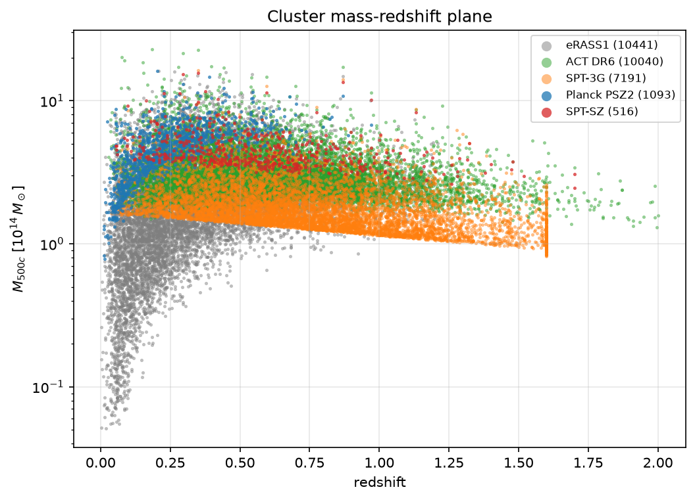
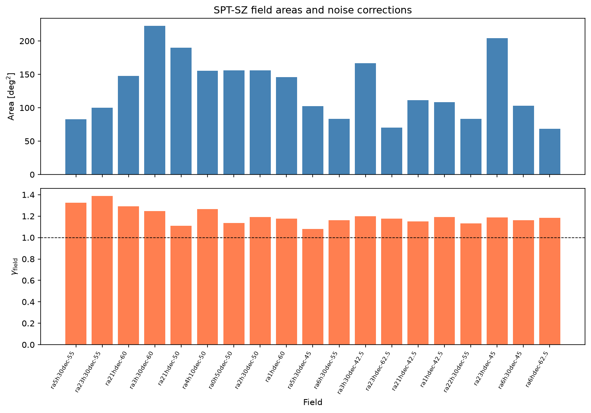

# clusters-mcp-server

**Galaxy Cluster Catalogs MCP Server.** An MCP server for public SZ, X-ray and optical galaxy-cluster catalogues:

- Planck PSZ2
- SPT-SZ 2500d (Bocquet+19), SPTpol 100d, SPT-ECS and SPT-3G Main 5yr
- ACT DR6
- eROSITA eRASS1, primary and cosmology samples
- DES Y6 WaZP optical clusters (Benoist+25), with the HEALPix footprint for areas

Each catalogue downloads on demand and is harmonised to one schema.

## Data products

| dataset | Catalogs | Summary statistics | Published results |
|---|---|---|---|
| psz2 | SZ cluster catalog (1653) | Completeness C(Y500, θ500) for MMF3/union masks | — |
| spt_sz | SZ cluster catalog (677) | Field areas + noise corrections (19 fields); Megacam (19, + source N(z)) / HST (13) WL shear profiles; NFW WL masses | σ8(Ωm/0.3)^0.2 = 0.766±0.025 (Bocquet+19) |
| sptpol_100d | SZ cluster catalog (89) | — | — |
| spt_ecs | SZ cluster catalog (470) | — | — |
| spt3g_5yr | SZ cluster catalog (8892) | — | — |
| act_dr6 | SZ cluster catalog (10040) | Q(θ500, z) per tile; tile RMS noise levels (293 tiles) | — |
| erass1 | X-ray cluster catalog (12247) | — | — |
| erass1_cosmo | Cosmology subsample (5259) | — | S8 = 0.86±0.01 (Ghirardini+24) |
| des_y6_wazp | Optical cluster catalog (416947, NGALS ≥ 5; members 13.1M on request) | HEALPix footprint (Nside 4096): 4544.7 deg², area(z) from the ZMAX depth map | — |

- All URLs were verified by download on 2026-11-04.
- Build analyses on catalogs and summary statistics; published results are for comparison only.
- The cache lives in `~/.cache/cosmo-mcp/clusters-mcp-server/`; override it with `$COSMO_MCP_DATA`.

**Selection functions:**
- **Planck PSZ2:** survey completeness C(Y500, θ500) at various SNR cuts, range-fetched from the 403 MB IRSA FITS (~120 KB tail).
- **ACT DR6:** Q-filter mismatch per tile (QFit.fits, 293 tiles) + tile noise levels (RMSTab), streamed from the 7.4 GB nemo tarball (~2 MB extracted).
- **SPT-SZ:** field-by-field areas and noise correction factors (Bocquet+19), hard-coded (no download).
- **eRASS1:** selection function not publicly released (Clerc+24 describes the method but data files are not downloadable).

**Weak-lensing shear profiles:**
- **SPT-SZ:** the 19 measured Megacam reduced-shear profiles of Dietrich+19 (8 bins, 0.75–2.5 Mpc) and their source N(z), from the official SPT-SZ likelihood release (Bocquet+19). `fetch_cluster_wl_profiles` writes one CSV per cluster (`r_deg, gt, gt_err, kbin, n_src, r_mpc`), the N(z) CSVs, and a README JSON.
- **`kbin`:** the 4th file column is undocumented, and the release's `lensing.py` never reads it. It is roughly constant per cluster (0.76–0.89) and anti-correlates with seeing (r = −0.92). Do not rescale g_t with it.
- **`fit_cluster_wl_mass`:** NFW fit following `lensing.py` (Σ_crit from ⟨β⟩, reduced shear with the ⟨β²⟩ correction). It reproduces the Dietrich+19 M500 of all 5 clusters the paper shows individually: ratios 0.99–1.005 with DK15 c(M).

**DES Y6 WaZP (optical):**
- Columns: ZPHOT, NGALS richness (the mass proxy), SNR, IN_COSMO and cover fraction. M500 is NaN.
- Footprint: HEALPix Nside 4096 NESTED. Effective area Σ DETFRAC = 4544.7 deg², which matches the 4,545 in the paper.
- Area where richness is complete (ZMAX > z): 4420 deg² at z = 0.7, 3176 at z = 0.8, 93 at z = 0.9.

| | |
|---|---|
|  |  |
|  |  |

## Harmonised schema

Every catalogue is written with these columns:
- name, ra, dec [deg]
- z, z_err
- **M500** [1e14 Msun, M500c], M500_err_lo, M500_err_hi
- snr: the survey-native statistic
- survey, dataset
- optical catalogues (des_y6_wazp) append: richness, richness_err (NGALS), z_spec, in_cosmo, cover_frac

**Masses come from each survey's own scaling relation.** Run `describe_catalog_columns` to see which.
WaZP has no mass. Mass tools handle it as follows:
- `plot_mass_redshift` skips it.
- `predict_cluster_counts_lcdm` refuses it.
- Counts use `richness_min` / N(>richness) instead.

## Tools

| tool | kind | what |
|---|---|---|
| `list_clusters_datasets`, `describe_clusters_dataset`, `list_clusters_skills`, `load_clusters_skill` | meta | discovery |
| `fetch_cluster_catalog` | catalog | download + harmonise + z/mass/SNR (or richness / in_cosmo) cuts → CSV; WaZP members on request |
| `describe_catalog_columns` | catalog | mapping, units, mass conventions, native FITS columns |
| `plot_mass_redshift` | catalog | multi-survey M500–z overlay |
| `plot_cluster_sky_map` | catalog | Mollweide map (equatorial/galactic), coloured by survey/z/M500/richness |
| `crossmatch_catalogs` | catalog | KD-tree angular + Δz/(1+z) one-to-one match → matched CSV |
| `compute_cluster_counts` | summary_statistic | N(z) and N(>M) (N(>richness) for WaZP) with Poisson errors, raw and per deg² (WaZP: depth-limited area per z bin) |
| `compute_wazp_footprint_area` | summary_statistic | DES Y6 WaZP effective area and area(ZMAX > z) from the HEALPix footprint |
| `compare_mass_calibration` | summary_statistic | M500_b vs M500_a: median ratio ± bootstrap, ln scatter |
| `fetch_cluster_selection_function` | summary_statistic | survey completeness (Planck/ACT/SPT) |
| `fetch_cluster_wl_profiles` | summary_statistic | measured Megacam g_t(r) profiles + source N(z) of 19 SPT-SZ clusters (Dietrich+19), with README of columns |
| `fit_cluster_wl_mass` | summary_statistic | NFW reduced-shear fit → M500c/M200c ± 68% per cluster; validated against Dietrich+19 |
| `plot_completeness` | summary_statistic | completeness heatmap (Planck) / noise histogram (ACT) / field bar (SPT) |
| `predict_cluster_counts_lcdm` (**heavy**) | summary_statistic | Tinker+08 × EH98 dN/dz above M for a sky area |
| `plot_counts_vs_prediction` | summary_statistic | observed N(z) vs LCDM with pulls and σ8 profile |
| `set_dispatch`, `get_dispatch`, `auth_status`, `export_dispatch_pack` | — | HPC dispatch (generic) |

## Skills

- `clusters-tour`
- `multi-survey-mass-redshift`
- `sz-xray-crossmatch`
- `selection-function-forward-model`
- `cluster-counts-vs-lcdm`
- `hpc-dispatch-handoff`

## Key numbers (verified)

- **Planck PSZ2 completeness:** 12 SNR thresholds (4.5–10), 32 θ500 bins (0.9–35′), 30 Y500 bins (1.1e-4–0.072 arcmin²). At q≥6 the survey is >80% complete above Y500 ≈ 4e-4 arcmin² for θ500 > 2′.
- **ACT DR6 selection function:** 293 tiles, total 12590 deg², median y0 RMS = 1.07e-5.
- **SPT-SZ WL:** 19 Megacam profiles, each 8 bins over 0.85–2.41 Mpc; 13 HST clusters are also in the release.
- **WL masses (DK15 c(M), M500c in 1e14 Msun), ours vs Dietrich+19:**
  - SPT-CLJ0516-5430: 7.66 vs 7.70
  - SPT-CLJ2022-6323: 3.74 vs 3.78
  - SPT-CLJ2030-5638: 2.74 vs 2.73
  - SPT-CLJ2032-5627: 9.13 vs 9.08
  - SPT-CLJ2135-5726: 7.59 vs 7.65
- **DES Y6 WaZP:** 416947 clusters. 301406 are IN_COSMO, and 33304 of those have NGALS ≥ 25. Area 4544.7 deg².
- **ACT DR6 × PSZ2** (3′): 386 matches. M_Planck/M_ACT = 0.80 ± 0.02, ln-scatter 0.34.
- **SPT-SZ, M500 > 5e14, z > 0.25:** LCDM (σ8=0.8) predicts 138 vs 105 observed → best σ8 ≈ 0.78.

## Install / run

```bash
uv venv --python 3.12 .venv && uv pip install --python .venv/bin/python -e ".[dev]"
MPLBACKEND=Agg .venv/bin/python -m pytest -q        # includes network tests
.venv/bin/python tests/smoke_server.py
./run_server.sh                                     # stdio; or: .venv/bin/python -m mcp_server --transport http --port 8014
```

## Caveats

- `predict_cluster_counts_lcdm` has no selection function, mass–observable scatter or Eddington bias. It is a sanity check, not a cosmology constraint.
- Cross-survey masses use different calibrations, with 5–25% offsets.
- eRASS1 selection function is not publicly released.
- WaZP has no mass-richness relation here, so richness counts cannot go into the M500-based LCDM prediction.
- WL masses from `fit_cluster_wl_mass` are raw NFW fits. They do not include the simulation-calibrated Megacam bias (0.938 ± 0.028) or LSS scatter.
