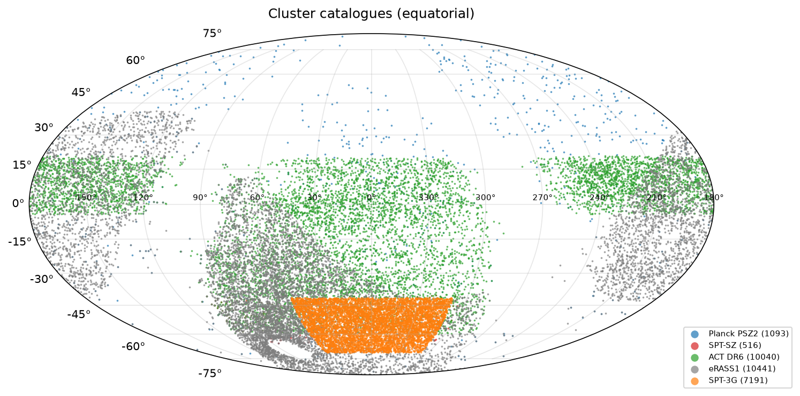
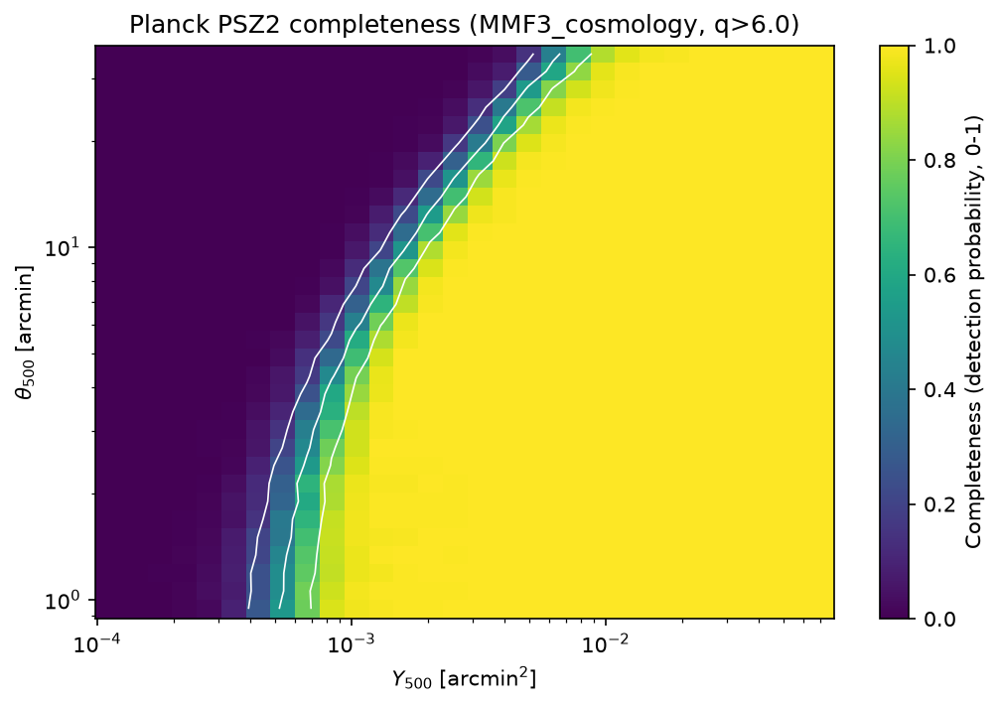
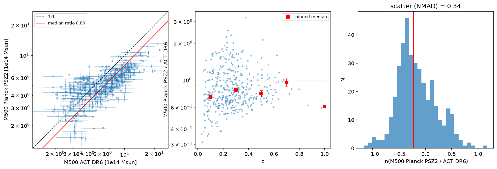
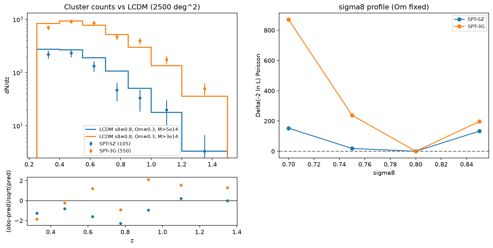

# clusters-mcp-server

MCP server for public galaxy-cluster catalogues: SZ (Planck, SPT, ACT), X-ray (eROSITA) and optical (DES Y6 WaZP).
It harmonises each catalogue to one schema and gives selection functions, SPT weak-lensing profiles and LCDM count predictions.
An agent can fetch and cut catalogues, cross-match surveys, compare mass calibrations, fit WL masses and compare N(z) with LCDM.

Part of the cosmo data MCP server family (sn · galaxy-surveys · cmb-data · weak-lensing · clusters). Default port: 8014.

## At a glance

| | |
|---|---|
| Surveys | Planck PSZ2, SPT-SZ 2500d, SPTpol 100d, SPT-ECS, SPT-3G Main 5yr, ACT DR6, eROSITA eRASS1 (primary + cosmology), DES Y6 WaZP |
| Tools | 22 (5 catalog, 9 summary statistic, 0 published result, 4 meta, 4 dispatch) |
| Skills | 6 (`skills/`) |
| Bundled data | 0.44 MB (PSZ2, SPT-SZ, SPTpol 100d, SPT-ECS catalogues) |
| Network | First use of SPT-3G, ACT DR6, eRASS1 and DES Y6 WaZP catalogues; `fetch_cluster_selection_function` and `plot_completeness` for Planck/ACT; `fetch_cluster_wl_profiles`, `fit_cluster_wl_mass`; `compute_wazp_footprint_area` with `use_footprint_file=True` |

## Data

| Dataset | Kind | Content | Shape and type | Source | Access |
|---|---|---|---|---|---|
| `psz2` Planck PSZ2 union | Catalog | SZ clusters: position, z, MSZ (M500c), SNR | table, 1653 rows × 30 cols (1093 with z and mass) | Planck 2015 XXVII, IRSA | Bundled (0.16 MB) |
| `psz2` completeness | Summary statistic | Completeness C(Y500, θ500) per SNR cut, MMF3-cosmology or union-survey mask | matrix stack (12 SNR cuts × 32 θ500 × 30 Y500) | Planck 2015 XXVII, IRSA | Download (~130 KB HTTP range of a 403 MB FITS) |
| `spt_sz` SPT-SZ 2500d | Catalog | SZ candidates: position, z, ξ, M500c (Bocquet+19) | table, 677 rows × 26 cols (516 with mass) | Bleem+15, Bocquet+19, pole.uchicago.edu | Bundled (0.14 MB) |
| `spt_sz` field selection | Summary statistic | Area and noise correction γ_f per field | table, 19 fields × 3 | Bocquet+19 (`SPTcluster_data.py`) | Bundled (in code) |
| `spt_sz` Megacam WL profiles | Summary statistic | Reduced tangential shear g_t(r) + source N(z) | 19 clusters × (table, 8 bins × 5 cols + vector, 200 z bins) | Dietrich+19, SPT-SZ likelihood release | Download (2.7 MB tar.gz) |
| `sptpol_100d` SPTpol 100d | Catalog | SZ candidates, ξ, M500c | table, 89 rows × 13 cols | Huang+20, pole.uchicago.edu | Bundled (0.02 MB) |
| `spt_ecs` SPT-ECS | Catalog | SZ candidates, ξ, M500c | table, 470 rows × 23 cols | Bleem+20, pole.uchicago.edu | Bundled (0.12 MB) |
| `spt3g_5yr` SPT-3G Main 5yr | Catalog | SZ candidates, ξ, M500c | table, 8892 rows × 30 cols (7190 with z and mass) | Bleem+26, LAMBDA | Download (2.6 MB) |
| `act_dr6` ACT DR6 | Catalog | SZ clusters, SNR, M500c (WL-consistent normalisation) | table, 10040 rows × 72 cols | ACT-DES-HSC (Hilton+) 2025, LAMBDA | Download (26 MB) |
| `act_dr6` selection function | Summary statistic | Q(θ500, z) per tile + tile area and y0 RMS noise | QFit: 293 tables × 55 rows × 3 cols; RMSTab: table, 13515 rows × 3 cols | Hilton+25, LAMBDA nemo products | Download (~2 MB extracted from a streamed 7.4 GB tarball) |
| `erass1` eRASS1 primary | Catalog | X-ray clusters, EXT_LIKE, M500 | table, 12247 rows × 85 cols | Bulbul+24, eROSITA DR1 | Download (24 MB .tgz, 51 MB unpacked) |
| `erass1_cosmo` eRASS1 cosmology | Catalog | Cosmology subsample, z_λ; M500 joined from primary | table, 5259 rows × 24 cols | Bulbul+24, eROSITA DR1 | Download (0.5 MB .tgz) |
| `erass1_cosmo` constraint | Published result | S8 = 0.86 ± 0.01, Ωm = 0.29 +0.01/−0.02 | scalar (registry entry) | Ghirardini+24 | Bundled (registry) |
| `des_y6_wazp` DES Y6 WaZP | Catalog | Optical clusters: z_phot, richness NGALS (≥ 5), SNR, IN_COSMO; no M500 | table, 416947 rows × 22 cols | Benoist+25, DES DR server | Download (80 MB) |
| `des_y6_wazp` members | Catalog | Cluster members: position, z_phot, PMEM, grizY mags | table, 13133244 rows × 14 cols | Benoist+25, DES DR server | Download (1.05 GB, only with `include_members=True`) |
| `des_y6_wazp` footprint | Summary statistic | Coverage DETFRAC and depth ZMAX per pixel; area 4544.7 deg² | map, HEALPix Nside 4096 NESTED, 22483619 pixels × 3 cols (PIXEL, DETFRAC, ZMAX) | Benoist+25, DES DR server | Download (540 MB, optional); area(z) table bundled in registry |

### Where the data comes from
- Bundled: four small FITS catalogues in `data/` (PSZ2, SPT-SZ, SPTpol 100d, SPT-ECS), 0.44 MB. The tour works offline with these.
- Download: other catalogues are fetched once over HTTPS and cached in `~/.cache/cosmo-mcp/clusters-mcp-server/` (override with `$COSMO_MCP_DATA`). URLs were verified on 2026-11-04 (WaZP on 2026-11-12).
- Planck completeness uses an HTTP range request for the tail HDUs only. ACT selection tables are extracted while streaming the 7.4 GB nemo tarball; nothing else is kept.
- WaZP footprint: `compute_wazp_footprint_area` uses an area(z) table in the registry by default. With `use_footprint_file=True` it downloads the 540 MB map once and caches a small `_zmaxhist.npz`.
- No tool queries a live database. Pre-fetch by calling `fetch_cluster_catalog` once per dataset.
- The eRASS1 selection function is not public and is not provided.

### Catalog columns

`fetch_cluster_catalog` writes every catalogue with these columns (NaN = missing):

| Column | Unit | Meaning |
|---|---|---|
| `name`, `ra`, `dec` | deg | Survey name and position |
| `z`, `z_err` | | Redshift and error |
| `M500`, `M500_err_lo`, `M500_err_hi` | 1e14 Msun | M500c from the survey's own scaling relation |
| `snr` | | Survey-native detection statistic (ξ, SNR or EXT_LIKE) |
| `survey`, `dataset` | | Survey label and registry key |
| `richness`, `richness_err`, `z_spec`, `in_cosmo`, `cover_frac` | | Optical catalogues only (`des_y6_wazp`): NGALS richness, spectroscopic z, IN_COSMO flag, coverage fraction within 1 Mpc |

- Masses come from different scaling relations. Run `describe_catalog_columns` before comparing surveys.
- WaZP has no mass. `plot_mass_redshift` skips it, `predict_cluster_counts_lcdm` refuses it, and counts use `richness_min` / N(>richness).

## Tools

### Catalog tools

| Tool | What it does | Data used | Output | Weight |
|---|---|---|---|---|
| `fetch_cluster_catalog` | Loads one catalogue, harmonises columns and applies z, M500, SNR, richness or IN_COSMO cuts. Optionally writes WaZP members of the selected clusters. | Any catalogue (Bundled / Download) | Harmonised CSV (+ members CSV) | light |
| `describe_catalog_columns` | Explains the column mapping, units, mass convention and native FITS columns of one catalogue. | Any catalogue (Bundled / Download) | Text / JSON summary | light |
| `plot_mass_redshift` | Overlays several catalogues in the M500–z plane. Draws only entries with z and M500. | Harmonised CSVs or dataset keys | PNG, counts per survey | light |
| `plot_cluster_sky_map` | Draws a Mollweide map (equatorial or galactic), coloured by survey, z, M500 or richness. | Harmonised CSVs or dataset keys | PNG | light |
| `crossmatch_catalogs` | Matches two catalogues one-to-one by angle (KD-tree) and Δz/(1+z). | Two harmonised CSVs or dataset keys | Matched CSV with sep_arcmin, dz, mass_ratio | light |

### Summary statistic tools

| Tool | What it does | Data used | Output | Weight |
|---|---|---|---|---|
| `compute_cluster_counts` | Histograms N(z) and N(>M500) (N(>richness) for WaZP) with Poisson errors, raw and per deg². WaZP uses the depth-limited area per z bin. | Harmonised CSVs or dataset keys; WaZP area(z) table | `counts_nz.csv`, `counts_nm.csv` / `counts_nrich.csv`, PNG | light |
| `compute_wazp_footprint_area` | Computes the WaZP effective area and the area with ZMAX > z. | WaZP footprint (registry table, or Download 540 MB) | area_vs_z CSV | light |
| `compare_mass_calibration` | Computes the median M500_b/M500_a with bootstrap error, ln scatter, ratio per z bin and an optional power-law slope. | CSV from `crossmatch_catalogs` | PNG, CSV of z-bin ratios | light |
| `fetch_cluster_selection_function` | Returns survey completeness: Planck C(Y500, θ500), ACT Q and tile noise, or SPT field areas and γ_f. | PSZ2 (Download, range), ACT DR6 (Download, streamed), SPT-SZ (Bundled) | CSV / JSON | light |
| `plot_completeness` | Plots Planck completeness at an SNR cut, the ACT y0 RMS histogram, or SPT field areas and γ_f. | Same as `fetch_cluster_selection_function` | PNG | light |
| `fetch_cluster_wl_profiles` | Writes the 19 measured SPT-SZ Megacam g_t(r) profiles and source N(z), with ⟨β⟩ per cluster. | SPT-SZ likelihood release (Download 2.7 MB) | 19 profile CSVs, 19 N(z) CSVs, summary CSV, README JSON | light |
| `fit_cluster_wl_mass` | Fits an NFW reduced-shear model with c(M,z) and Σ_crit from N(z). Gives M500c and M200c with 68% intervals and the ratio to Dietrich+19. | SPT-SZ likelihood release (Download 2.7 MB) | Mass CSV, JSON, PNG | light |
| `predict_cluster_counts_lcdm` | Predicts LCDM dN/dz above an M500c threshold (Tinker+08 HMF × Eisenstein-Hu P(k)) and compares with a catalogue. Optional σ8 Poisson profile. | Observed catalogue (Bundled / Download); model in code | CSV, JSON | heavy |
| `plot_counts_vs_prediction` | Plots observed N(z) against one or more LCDM predictions, with residuals and the σ8 profile. | JSON from `predict_cluster_counts_lcdm` | PNG | light |

### Published result tools

None. The published constraints (Planck 2015 XXIV, Bocquet+19, Bocquet+24, Ghirardini+24) are registry entries for comparison only.

### Meta and dispatch tools

| Tool | What it does | Data used | Output | Weight |
|---|---|---|---|---|
| `list_clusters_datasets` | Lists datasets by kind, with access and the tools that read them. | Registry | JSON | light |
| `describe_clusters_dataset` | Describes one dataset: products, units, conventions, URLs, citation. | Registry | JSON | light |
| `list_clusters_skills` | Lists the skills (multi-tool recipes). | `skills/` | JSON | light |
| `load_clusters_skill` | Returns the full instructions of one skill. | `skills/` | Text | light |
| `auth_status` | Reports whether this server is signed in to ALCF/NERSC for HPC dispatch. | none | JSON | light |
| `get_dispatch` | Reports where heavy tools run now (local or an HPC facility). | none | JSON | light |
| `set_dispatch` | Sets where heavy tools run: local, polaris (ALCF) or perlmutter (NERSC). | none | JSON | light |
| `export_dispatch_pack` | Exports this server's compute kernels so a client can run them on HPC. | `tools/` | Files + manifest | light |

## Example figures

| | |
|---|---|
|  |  |
| Multi-survey M500–z plane (`plot_mass_redshift`) | Equatorial sky map of the catalogues (`plot_cluster_sky_map`) |
|  |  |
| Planck PSZ2 completeness, MMF3 cosmology mask (`plot_completeness`) | SPT-SZ field areas and noise corrections (`plot_completeness`) |
|  |  |
| ACT DR6 vs Planck PSZ2 masses (`compare_mass_calibration`) | SPT-SZ N(z) vs LCDM (`plot_counts_vs_prediction`) |

## Validation

| Check | This server | Reference |
|---|---|---|
| Catalogue sizes | PSZ2 1653, SPT-SZ 677, ACT DR6 10040, SPT-3G 8892, eRASS1 12247, eRASS1 cosmo 5259, WaZP 416947 | Registry / papers |
| WaZP IN_COSMO and rich sample | 301406 IN_COSMO; 33304 with NGALS ≥ 25 | Benoist+25 (~33k) |
| WaZP effective area | 4544.7 deg² | Benoist+25: 4,545 deg² |
| WaZP area with ZMAX > z | 4420.5 (z = 0.7), 3176.0 (z = 0.8), 93.0 (z = 0.9) deg² | Footprint FITS |
| Planck PSZ2 completeness grid | 12 SNR cuts (4.5–10), 32 θ500 bins (0.9–35′), 30 Y500 bins (1.1e-4–0.072 arcmin²); > 80% complete above Y500 ≈ 4e-4 arcmin² for θ500 > 2′ at q ≥ 6 | Planck 2015 XXVII |
| ACT DR6 selection function | 293 tiles, 12590 deg², median y0 RMS 1.07e-5 | Hilton+25 |
| SPT-SZ Megacam profiles | 19 clusters, 8 bins each over 0.85–2.41 Mpc; ⟨β⟩, ⟨β²⟩ within 0.015 | Dietrich+19 Table 3 |
| WL masses, M500c [1e14 Msun], DK15 c(M) | 0516−5430: 7.66; 2022−6323: 3.74; 2030−5638: 2.74; 2032−5627: 9.13; 2135−5726: 7.59 | Dietrich+19: 7.70, 3.78, 2.73, 9.08, 7.65 |
| ACT DR6 × PSZ2 (3′) | 386 matches; M_Planck/M_ACT = 0.80 ± 0.02, ln scatter 0.34 | Hydrostatic 1−b ≈ 0.8 |
| SPT-SZ, M500 > 5e14, z > 0.25 | LCDM (σ8 = 0.8) 138 vs 105 observed; best σ8 ≈ 0.78 | Bocquet+19: σ8 = 0.781 ± 0.037 |
| Tinker+08 HMF kernel | Within 4% of colossus | colossus (`tests/test_clusters.py`) |

## Skills

| Skill | Use it to |
|---|---|
| `clusters-tour` | Run one call per tool family with expected numbers. |
| `multi-survey-mass-redshift` | Reproduce the SZ/X-ray M500–z comparison figure with completeness notes. |
| `sz-xray-crossmatch` | Cross-match SZ and X-ray catalogues and measure relative mass calibration. |
| `selection-function-forward-model` | Extract Planck, ACT and SPT selection functions and WL profiles for forward modelling. |
| `cluster-counts-vs-lcdm` | Compare observed N(z) with LCDM, with pulls and a σ8 profile. |
| `hpc-dispatch-handoff` | Run heavy kernels on ALCF Polaris or NERSC Perlmutter. |

## Install and run

```bash
python -m venv .venv && .venv/bin/pip install -e ".[dev]"
.venv/bin/python -m mcp_server                 # stdio (or ./run_server.sh)
.venv/bin/python -m mcp_server --transport streamable-http --port 8014
MPLBACKEND=Agg .venv/bin/python -m pytest -q    # tests (network tests: -m network)
```

## Limitations

- `predict_cluster_counts_lcdm` has no selection function, mass–observable scatter or Eddington bias. It is a sanity check, not a cosmology constraint.
- Cross-survey masses use different calibrations, with 5–25% offsets.
- The eRASS1 selection function is not public.
- WaZP has no mass–richness relation here. Richness counts cannot go into the M500-based LCDM prediction.
- `fit_cluster_wl_mass` gives raw NFW masses. It does not apply the simulation-calibrated Megacam bias (0.938 ± 0.028) or LSS scatter.
- WL profiles exist only for SPT-SZ Megacam. The 13 HST clusters in the release are not exposed by a tool.
- The `kbin` column of the Megacam profiles is undocumented and unused by the release's `lensing.py`. Do not rescale g_t with it.

## Citation

- Planck PSZ2: Planck Collaboration 2016, A&A 594, A27 (arXiv:1502.01598).
- SPT-SZ 2500d: Bleem et al. 2015, ApJS 216, 27; Bocquet et al. 2019, ApJ 878, 55 (arXiv:1812.01679).
- SPT-SZ Megacam WL: Dietrich et al. 2019, MNRAS 483, 2871 (arXiv:1711.05344).
- SPTpol 100d: Huang et al. 2020, AJ 159, 110 (arXiv:1907.09621).
- SPT-ECS: Bleem et al. 2020, ApJS 247, 25 (arXiv:1910.04121).
- SPT-3G Main 5yr: Bleem et al. 2026 (arXiv:2607.01175).
- ACT DR6: ACT-DES-HSC Collaboration (Hilton et al.) 2025 (arXiv:2507.21459).
- eRASS1: Bulbul et al. 2024, A&A 685, A106; Ghirardini et al. 2024, A&A 689, A298.
- DES Y6 WaZP: Benoist et al. 2025 (arXiv:2507.05360); Aguena et al. 2021, MNRAS 502, 4435.
- Halo mass function: Tinker et al. 2008, ApJ 688, 709; Eisenstein & Hu 1998, ApJ 496, 605.
