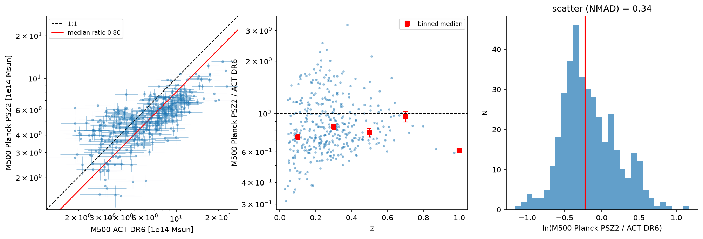
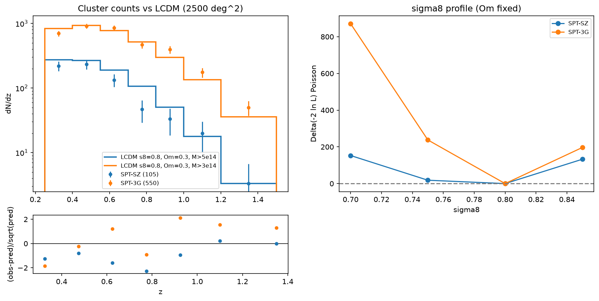

# clusters-mcp-server

**Galaxy Cluster Catalogs MCP Server.** An MCP server for public SZ and X-ray galaxy-cluster catalogues:

- Planck PSZ2
- SPT-SZ 2500d (Bocquet+19), SPTpol 100d, SPT-ECS and SPT-3G Main 5yr
- ACT DR6
- eROSITA eRASS1, primary and cosmology samples

Each catalogue downloads on demand and is harmonised to one schema.

**Tools.** The server includes tools to:

- plot the multi-survey M500–z plane and Mollweide sky maps
- build N(z) and N(>M) counts
- crossmatch catalogues by angle and redshift, and compare mass calibrations
- predict LCDM cluster counts with a Tinker+08 HMF × Eisenstein–Hu P(k), pure numpy/scipy, dispatchable to HPC

It is part of the `cosmo-*-mcp-server` family (port 8014), built from `cosmo-mcp-template`. See `docs/CONVENTIONS.md`.

| | |
|---|---|
|  |  |
|  |  |

## Datasets

| key | catalogue | N | access | source |
|---|---|---|---|---|
| psz2 | Planck PSZ2 union R2.08 | 1653 | bundled (+IRSA) | https://irsa.ipac.caltech.edu/data/Planck/release_2/catalogs/HFI_PCCS_SZ-union_R2.08.fits.gz |
| spt_sz | SPT-SZ 2500d, Bocquet+19 masses | 677 | bundled (+pole) | https://pole.uchicago.edu/public/data/sptsz-clusters/2500d_cluster_sample_Bocquet19.fits |
| sptpol_100d | SPTpol 100d (Huang+20) | 89 | bundled (+pole) | https://pole.uchicago.edu/public/data/sptsz-clusters/sptpol100d_catalog_huang19.fits |
| spt_ecs | SPT-ECS (Bleem+20) | 470 | bundled (+pole) | https://pole.uchicago.edu/public/data/sptsz-clusters/sptecs_catalog_oct919.fits |
| spt3g_5yr | SPT-3G Main field 5yr | 8892 | download | https://lambda.gsfc.nasa.gov/data/suborbital/SPT/spt_3gsz/spt3g_main_field_5yr_clusters_070126.fits |
| act_dr6 | ACT DR6 SZ clusters (ACT Collab. 2025) | 10040 | download | https://lambda.gsfc.nasa.gov/data/suborbital/ACT/actadv_dr6_cluster_cat/DR6_cluster-catalog_v1.0.fits |
| erass1 | eRASS1 primary clusters (Bulbul+24) | 12247 | download | https://erosita.mpe.mpg.de/dr1/AllSkySurveyData_dr1/Catalogues_dr1/BulbulE_DR1/erass1cl_primary_v3.2.fits.tgz |
| erass1_cosmo | eRASS1 cosmology sample (Ghirardini+24) | 5259 | download | https://erosita.mpe.mpg.de/dr1/AllSkySurveyData_dr1/Catalogues_dr1/BulbulE_DR1/erass1cl_cosmology_v1.1.fits.tgz |

- All URLs were verified by download on 2026-11-04.
- The eROSITA bare `.fits` URLs return HTTP 403; the `.fits.tgz` archives work.
- The cache lives in `~/.cache/cosmo-mcp/clusters-mcp-server/`; override it with `$COSMO_MCP_DATA`.

**Harmonised schema.** Every catalogue is written with these columns:

- name, ra, dec [deg]
- z, z_err
- **M500** [1e14 Msun, M500c], M500_err_lo, M500_err_hi
- snr: the survey-native statistic
- survey, dataset

**Masses come from each survey's own scaling relation.** Run `describe_catalog_columns` to see which. In particular, Planck PSZ2 MSZ is hydrostatic and sits about 20% low.

## Tools

| tool | what |
|---|---|
| `list_clusters_datasets`, `describe_clusters_dataset`, `list_clusters_skills`, `load_clusters_skill` | meta |
| `fetch_cluster_catalog` | download + harmonise + z/mass/SNR cuts → CSV |
| `describe_catalog_columns` | mapping, units, mass conventions, native FITS columns |
| `plot_mass_redshift` | multi-survey M500–z overlay |
| `plot_cluster_sky_map` | Mollweide map (equatorial/galactic), coloured by survey/z/M500 |
| `compute_cluster_counts` | N(z) and N(>M), raw and per deg² |
| `crossmatch_catalogs` | KD-tree angular + Δz/(1+z) one-to-one match → matched CSV + mass ratios |
| `compare_mass_calibration` | M500_b vs M500_a: median ratio ± bootstrap, ln scatter, z trend, bisector slope |
| `predict_cluster_counts_lcdm` (**heavy**) | Tinker+08 × EH98 dN/dz above M for a sky area, obs/pred, Poisson σ8 profile |
| `plot_counts_vs_prediction` | observed N(z) vs LCDM with pulls and σ8 profile |
| `set_dispatch`, `get_dispatch`, `auth_status`, `export_dispatch_pack` | HPC dispatch (generic) |

The HMF kernel (`tools/lcdm/kernels.py`, `lcdm.kernels.predict_counts`) needs only numpy and scipy:

- **Accuracy:** agrees with `colossus` Tinker08 + `eisenstein98_zb` to 1–2% for 3e13–1e15 M☉/h, and to ≤5% at 3e15.
- **Speed:** about 0.2 s per prediction.

## Skills

- `clusters-tour`
- `multi-survey-mass-redshift`
- `sz-xray-crossmatch`
- `cluster-counts-vs-lcdm`
- `hpc-dispatch-handoff`

## Key numbers (tour, verified)

- **ACT DR6 × PSZ2** (3′): 386 matches. M_Planck/M_ACT = 0.80 ± 0.02, ln-scatter 0.34. This is the Planck hydrostatic bias, 1−b ≈ 0.8.
- **SPT-SZ × eRASS1** (2′): 330 matches. M_eRASS1/M_SPT = 0.95 ± 0.01.
- **SPT-SZ, M500 > 5e14, z > 0.25:** LCDM (σ8 = 0.8, Ωm = 0.3) predicts 138 against 105 observed. The Poisson-only best fit is σ8 ≈ 0.78 (Bocquet+19: 0.77).
- **SPT-3G, M500 > 3e14:** 542 predicted, 550 observed.

## Install / run

```bash
uv venv --python 3.12 .venv && uv pip install --python .venv/bin/python -e ".[dev]"
MPLBACKEND=Agg .venv/bin/python -m pytest -q        # includes network tests
.venv/bin/python tests/smoke_server.py
PYTHONPATH=. MPLBACKEND=Agg .venv/bin/python scripts/run_tour.py output/tour
./run_server.sh                                     # stdio; or: .venv/bin/python -m mcp_server --transport http --port 8014
```

## Caveats

- `predict_cluster_counts_lcdm` has no selection function, mass–observable scatter or Eddington bias. It is a sanity check, not a cosmology constraint.
- Cross-survey masses use different calibrations, with 5–25% offsets between them.
- PSZ2 and eRASS1 count deficits relative to LCDM reflect incompleteness and the mass scale; they do not indicate new physics.
